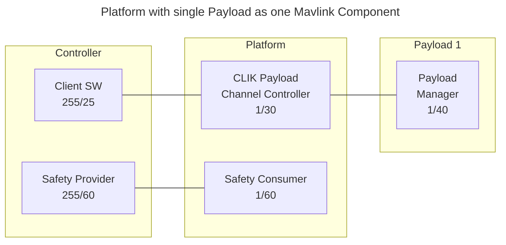
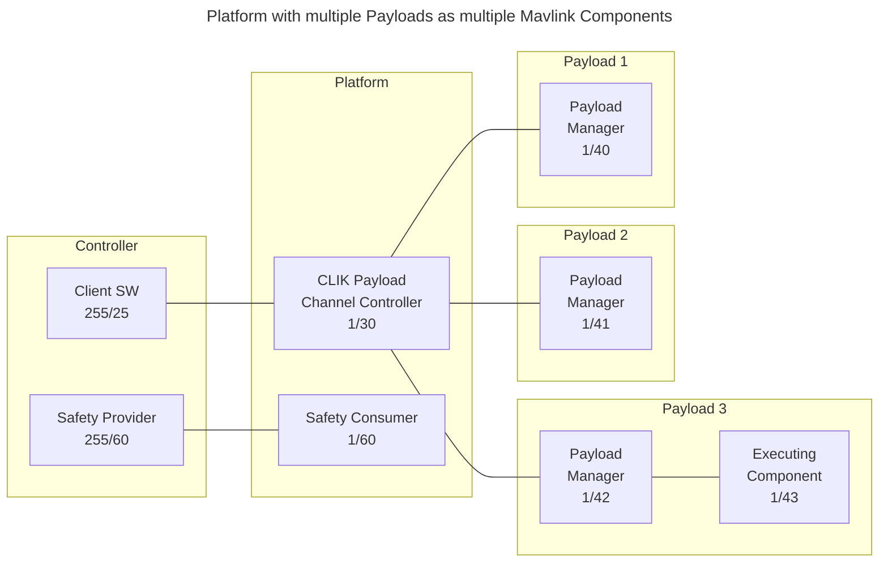
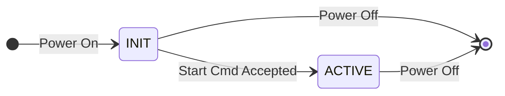
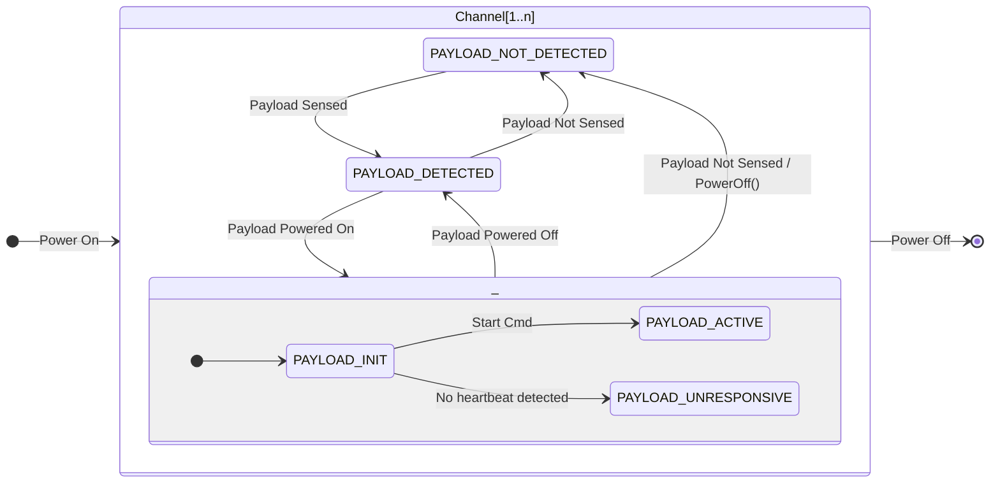

# Common Lethality Integration Kit Protocol

## Introduction

The Picatinny CLIK Design Standard is being developed by Combat Capabilities Development Command (DEVCOM) Armaments Center (AC) as a standardized means of pairing lethal payloads to platforms. The purpose of this standard is to minimize the proliferation of physical, electronic, and data interface standards between unmanned platforms and payloads. 

The CLIK ecosystem consists of three primary component types: Platforms, Payloads, and Controllers. One or more Payloads physically attach themselves to a Platform. For the most basic of CLIK systems, that is where the integration effort ends. A fully integrated CLIK system incorporates full sharing of power, safety, and data communication between the Platform, its Payloads, and one or more Controllers. 

CLIK does not limit itself to a single physical interface. Interface attributes like physical mounting, electrical connections, electrical signals, power bus voltage, and data busses are defined by a specific CLIK Payload Interface Type. Core attributes like safety and data communication messaging are kept common to maximize interoperability. The MAVLink Military protocol has been selected as the data communication protocol for CLIK. Its wide adoption, data bus agnostic protocol, and broad availability of services and definitions make it well suited for the goals of CLIK. It is responsible for facilitating command and state data transfer between CLIK devices. This includes configuration of safety devices and black channel transport of the safety state data.

> [!NOTE]
> The information contained in this repository is intended to be used in conjunction with the [Picatinny CLIK Design Standard](https://ac.devcom.army.mil/picatinny-clik/). Additional information including required MAVLink services, device parameters, and timing requirements are documented in Part 2 of the Design Standard.

## Concepts

There a four types of CLIK devices recognized as disctinct MAVLink component types.
* **CLIK_TYPE_PAYLOAD:** a device which attaches to a platform and adds some new functionality to the platform.
* **CLIK_TYPE_PLATFORM:** detects the presence of attached payloads, monitors and controls payload power, assigns one or more system unique component identifiers when a payload powers on, routes MAVLink messages to/from payloads.
* **CLIK_TYPE_SAFETY_CONSUMER:** entity that implements the data sink of a unidirectional safety communication link as defined in IEC 62541-15.
* **CLIK_TYPE_SAFETY_PROVIDER:** entity that implements the data source of a unidirectional safety communication link as defined in IEC 62541-15.

Each CLIK component is identified by its unique combination of System Identifier and Component Identifier. A MAVLink component is identified as being a CLIK device by its [`HEARTBEAT`](https://mavlink.io/en/messages/common.html#HEARTBEAT) [`MAV_TYPE`](https://mavlink.io/en/messages/common.html#MAV_TYPE) field being set to [`MAV_TYPE_CLIK`](../messages/clik.md#MAV_TYPE_CLIK). The custom_mode field is set to the appropriate [`CLIK_TYPE`](../messages/clik.md#CLIK_TYPE).

The CLIK MAVLink definitions are currently implemented as a private extension to the MAVLink Military dialect and are defined in the [clik.xml](../messages/clik.xml) file.

### CLIK Platform

A CLIK Platform implements one or more payload channels corresponding with the number of interfaces it implements per the requirements of a specified CLIK Payload Interface Type. The Platform MAVLink interface provides important information to a controller via the [Parameter Protocol](https://mavlink.io/en/services/parameter.html). This includes: number of payload channels, electrical current limits, and weight capacities. 

The MAVLink messages for the platform primarily provide state data as it relates to the CLIK functionality via the [`CLIK_IDENT`](../messages/clik.md#CLIK_IDENT), [`CLIK_PLATFORM_STATUS`](../messages/clik.md#CLIK_PLATFORM_STATUS), and [`CLIK_PLATFORM_CHAN_STATUS`](../messages/clik.md#CLIK_PLATFORM_CHAN_STATUS) messages. This includes: identification information, state of safety signals, power measurements, and payload communication states for the platform as a whole and for each channel instance. CLIK platforms include the ability to control power output to attached payload(s). Control of power is implemented via the [`MAV_CMD_CLIK_PWR_SET`](../messages/clik.md#MAV_CMD_CLIK_PWR_SET) command.

The CLIK Platform is responsible for assigning unique identifiers when a payload is first powered on as defined in [Payload Initialization](#payload-initialization). Once a payload is configured it is enabled and at that time behaves as a MAVLink component. The CLIK Platform then detects the heartbeats containing the assigned identifiers and routes them in accordance with MAVLink [routing](https://mavlink.io/en/guide/routing.html) guidelines.

### CLIK Payload

A CLIK Payload directly implements the MAVLink Military Generic Payload Protocol. Every CLIK Payload implements exactly one Payload Manager instance which provides access to the Payload's functions and other services. In most cases the Payload is presented with a single payload_id though a Payload developer could choose to represent itself using multiple IDs. One possible use case would be a payload which itself implements additional sub-payloads.

### CLIK Safety

A CLIK Safety Producer and Safety Consumer pair are responsible for recreating inputs captured at the controller on the platform for distribution to attached payloads. The safety data itself is communicated in accordance with IEC 62541-15 (OPC Unified Architecture - Part 15: Safety). Communications are initiated by the Safety Consumer which resides on the platform. A Safety Consumer is configured to request data from a single Safety Provider. It periodically sends requests to the Safety Provider for the current safety data. There are several features incorporated into the IEC standard to ensure detection of faulty data. This includes sequence numbers, a watchdog timer, identifiers, and CRC checks. If the message received in response to a request fails any of these mechanisms the outputs are forced to their fail-safe states.

This functionality is broken out to support the ability to meet the stricter requirements often imposed on safety critical systems. For example, a dedicated hardware component can be developed to collect and transmit the user inputs at the controller. A similar component would receive that data and generate the resultant signals which in turn are provided globally to attached payloads. These components could be developed to meet whatever safety requirements the application requires without imposing those requirements on the system as a whole. The typical use case would be for a payload to use these signals in conjunction with software commands and any payload specific safety interlocks. Additional information on CLIK safety architecture can be found in Part 3 of the Design Standard.

A CLIK Safety entity uses MAVLink communications for two purposes. The first is for configuration and monitoring. The Safety Consumer needs to be configured for the intended Safety Provider.  

TODO
* Identify support messages and commands

### Configuration Examples

The following diagrams show some architectural examples of the MAVLink components making up a CLIK system.

## Payload Initialization

A Payload can be dynamically added and removed from a platform. This poses a problem for MAVLink as all components on a MAVLink data bus are required to have a unique combination of System and Component identifiers. CLIK addresses this issue by assigning identifiers at payload power on. 

The state diagram below shows the behavior of a CLIK payload data interface on power up. When initially powered on it enters an INIT state where it identifies itself using the Heartbeat Protocol as described above but with a fixed System Identifier set to 1 and Component Identifier set to MAV_COMP_ID_USER1 (25). While in the INIT state the payload only implements the heartbeat and command protocol. The  [`MAV_CMD_CLIK_INIT_SET_IDS`](../messages/clik.md#MAV_CMD_CLIK_INIT_SET_IDS) command is used by the platform to set the payload's system and component identifiers. The first value set is always used as the identifiers for the Payload Manager. The platform continues to send additional unique identifier values. The payload indicates successful assignment by returning MAV_RESULT_ACCEPTED as the MAV_RESULT. Once all required identifiers have been assigned the payload indicates this by returning MAV_RESULT_TEMPORARILY_REJECTED. Invalid identifier values result in a MAV_RESULT_DENIED response. The payload also accepts the SETUP_SIGNING cmd to configure it message signing key. Once configuration of the payload is completed the [`MAV_CMD_CLIK_INIT_START`](../messages/clik.md#MAV_CMD_CLIK_INIT_START) command is issued by the platform to beging normal payload operations. The Payload returns MAV_RESULT_ACCEPTED or MAV_RESULT_TEMPORARILY_REJECTED if the payload has not yet been fully configured. Once the Start command is accepted the payload transitions to its ACTIVE state.

The state diagram below shows the behavior of a platform payload channel's data interface. A platform implements one or more channels to communicate with paired payloads and each channel implements its own independant instance of this state machine. Once a channel has detected the presence of a mated payload and supplied it with power it enters its PAYLOAD_INIT state. In this state it listens for the payloads INIT state heartbeat. The channel can then configure and startthe payload. Once the command to start has been sent and confirmed the platform implements the typical MAVLink data bus functions and sets its state to PAYLOAD_ACTIVE. A platform may decide to transition to a PAYLOAD_UNRESPONSIVE state if no heartbeat is received after a period of time. If it becomes necessary to assign new identifiers the platform channel must cycle power to the payload to reset it back to its INIT state.

