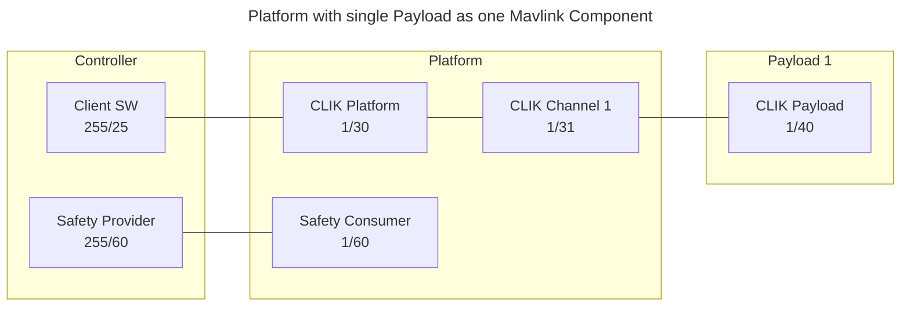
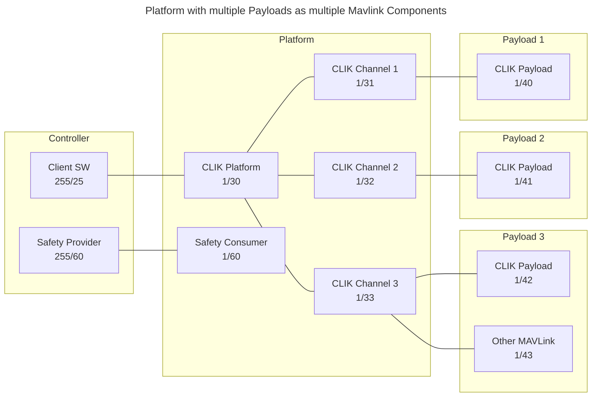
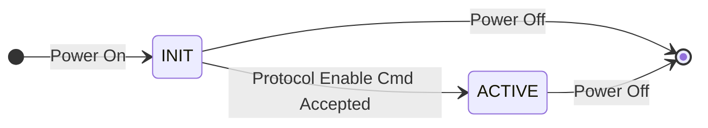
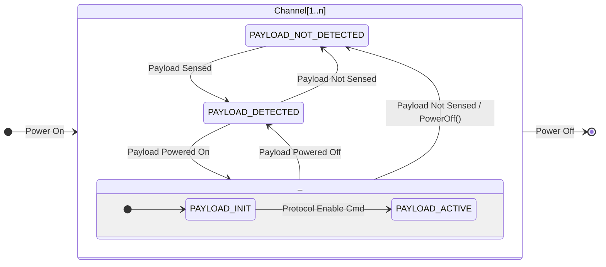

# Common Lethality Integration Kit Protocol

## Introduction

The Picatinny CLIK Design Standard is being developed by Combat Capabilities Development Command (DEVCOM) Armaments Center (AC) as a standardized means of pairing lethal payloads to platforms. The purpose of this standard is to minimize the proliferation of physical, electronic, and data interface standards between unmanned platforms and payloads. 

The CLIK ecosystem consists of three primary component types: Platforms, Payloads, and Controllers. One or more Payloads physically attach themselves to a Platform. For the most basic of CLIK systems, that is where the integration effort ends. A fully integrated CLIK system incorporates full sharing of power, safety, and data communication between the Platform, its Payloads, and one or more Controllers. 

CLIK does not limit itself to a single physical interface. Interface attributes like physical mounting, electrical connections, electrical signals, power bus voltage, and data busses are defined by a specific CLIK Payload Interface Type. Core attributes like safety and data communication messaging are kept common to maximize interoperability. The MAVLink Military protocol has been selected as the data communication protocol for CLIK. Its wide adoption, data bus agnostic protocol, and broad availability of services and definitions make it well suited for the goals of CLIK. It is responsible for facilitating command and state data transfer between CLIK devices. This includes configuration of safety devices and black channel transport of the safety state data.

> [!NOTE]
> The information contained in this repository is intended to be used in conjunction with the [Picatinny CLIK Design Standard](https://ac.devcom.army.mil/picatinny-clik/). Additional information including required MAVLink services, device parameters, and timing requirements are documented in Part 2 of the Design Standard.

## Concepts

CLIK devices are implemented in MAVLink as independant MAVLink components, each identified by their unique combination of System Identifier and Component Identifier. A MAVLink component is identified as being a CLIK device by its [`HEARTBEAT`](https://mavlink.io/en/messages/common.html#HEARTBEAT) [`MAV_TYPE`](https://mavlink.io/en/messages/common.html#MAV_TYPE) field being set to [`MAV_TYPE_CLIK`](../messages/clik.md#MAV_TYPE_CLIK). The custom_mode field is set to the appropriate [`CLIK_TYPE`](../messages/clik.md#CLIK_TYPE).

There a four types of CLIK devices recognized as disctinct MAVLink component types.
* **CLIK_TYPE_PLATFORM:** detects the presence of attached payloads, monitors and controls payload power, assigns one or more system unique component identifiers when a payload powers on, routes MAVLink messages to/from payloads.
* **CLIK_TYPE_PAYLOAD:** a device which attaches to a platform and adds some new function or capability to the platform.
* **CLIK_TYPE_SAFETY_PROVIDER:** entity that implements the data source of a unidirectional safety communication link as defined in IEC 62541-15.
* **CLIK_TYPE_SAFETY_CONSUMER:** entity that implements the data sink of a unidirectional safety communication link as defined in IEC 62541-15. 

The CLIK MAVLink definitions are currently implemented as a private extension to the MAVLink Military dialect and are defined in the [clik.xml](../messages/clik.xml) file.

### CLIK Platform

A CLIK Platform implements one or more payload channels corresponding with the number of interfaces it implements per the requirements of a specified CLIK Payload Interface Type. The Platform MAVLink interface provides important information to a controller via the [Paramter Protocol](https://mavlink.io/en/services/parameter.html). This includes: number of payload channels, electrical current limits, and weight capacities. 

The MAVLink messages for the platform primarily provide state data as it relates to the CLIK functionality via the [`CLIK_IDENT`](../messages/clik.md#CLIK_IDENT), [`CLIK_PLATFORM_STATUS`](../messages/clik.md#CLIK_PLATFORM_STATUS), and [`CLIK_PLATFORM_CHAN_STATUS`](../messages/clik.md#CLIK_PLATFORM_CHAN_STATUS) messages. This includes: identification information, state of safety signals, power measurements, and payload communication states for the platform as a whole and for each channel instance. CLIK platforms include the ability to control power output to attached payload(s). Control of power is implemented via the [`MAV_CMD_CLIK_PWR_SET`](../messages/clik.md#MAV_CMD_CLIK_PWR_SET) command.

The CLIK Platform is responsible for assigning unique identifiers when a payload is first powered on as defined in [Payload Initialization](#payload-initialization). Once a payload is configured it is enabled and at that time behaves as a MAVLink component. The CLIK Platform then detects the heartbeats containing the assigned identifiers and routes them in accordance with MAVLink [routing](https://mavlink.io/en/guide/routing.html) guidelines.

### CLIK Payload

A CLIK Payload implements one or more MAVLink component interfaces. At least one of these interfaces must be a CLIK Payload device type. Additional non-CLIK interfaces are also permissible. For example, a payload could implement a lethal function in combination with its own dedicated video stream conforming to the [Camera Protocol](https://mavlink.io/en/services/camera.html).

TODO
* Identify support messages and commands
* Discuss capabilities
* Add diagrams of use cases

### CLIK Safety

A CLIK Safety Producer and Safety Consumer pair are responsible for recreating inputs captured at the controller on the platform for distribution to attached payloads. The safety data itself is communicated in accordance with IEC 62541-15 (OPC Unified Architecture - Part 15: Safety). Communications are initiated by the Safety Consumer which resides on the platform. A Safety Consumer is configured to request data from a single Safety Provider. It periodically sends requests to the Safety Provider for the current safety data. There are several features incorporated into the IEC standard to ensure detection of faulty data. This includes sequence numbers, a watchdog timer, identifiers, and CRC checks. If the message received in response to a request fails any of these mechanisms the outputs are forced to their fail-safe states.

This functionality is broken out to support the ability to meet the stricter requirements often imposed on safety critical systems. For example, a dedicated hardware component can be developed to collect and transmit the user inputs at the controller. A similar component would receive that data and generate the resultant signals which in turn are provided globally to attached payloads. These components could be developed to meet whatever safety requirements the application requires without imposing those requirements on the system as a whole. The typical use case would be for a payload to use these signals in conjunction with software commands and any payload specific safety interlocks. Additional information on CLIK safety architecture can be found in Part 3 of the Design Standard.

A CLIK Safety entity uses MAVLink communications for two purposes. The first is for configuration and monitoring. The Safety Consumer needs to be configured for the intended Safety Provider.  

TODO
* Identify support messages and commands

### Configuration Examples

The following diagrams show some architectural examples of the MAVLink components making up a CLIK system.

## Payload Initialization

A Payload can be dynamically added and removed from a platform. This poses a problem for payloads supporting different data protocols or protocols which need additional configuration prior to becoming active. The Payload Initialization Protocol addresses this issue by acting as a lightweight bootstrapping interface for identifying protocol support and performing any configuration steps necessary to bring a given protocol online.

A Payload may support multiple protocols. It may also support multiple instances of the same protocol on different interfaces. Which protocols are supported and where they are made available is dependent on the application and the selected Payload Interface Type.

The state diagram below shows the behavior of a CLIK payload data interface on power up. When initially powered on it enters an INIT state where it implements the initialization protocol defined in this section. Once the data interface has been configured and a valid Protocol Enable Cmd has been received the data interface transitions to its ACTIVE state where it implements the selected protocol. Note that while a data interface can support multiple instances of a protocol it only implements one instance of the initialization protocol. For example, a serial port data interface may be the endpoint for multiple MAVLink components but while in the INIT state it uses a single initialization instance for configuration. Data interfaces are defined in their respective CLIK Payload Interface Type portions of the CLIK Design Standard.

The state diagram below shows the behavior of a platform channel's payload data interface. A platform implements one or more channels to communicate with paired payloads and each channel implements its own independant instance of this state machine. Once a platform channel has detected the presence of a mated payload and supplied it with power it enters its PAYLOAD_INIT state. In this state it shall periodically query the payload to determine what protocols it implements. The platform can then configure and enable, if applicable, one of the available protocols. Once the command to enable the protocol has been sent and confirmed the platform implements the selected protocol to sets its state to PAYLOAD_ACTIVE. If it is necessary to change to a different protocol the platform channel must cycle power to the payload to reset it back to its INIT state.

### Initialization Protocol

A simple protocol is implemented independently from MAVLink to avoid being confused for the MAVLink protocol. A single start of frame byte is used to indicate the start of the message and a CRC is appended to the end using the same algorithm as MAVLink for greater code reuse. A single shared message is utilized for both the platform command to a Payload and its response. 

| Byte |    Data Type    |     Description                         |
| ---- | --------------- | --------------------------------------- |
| 1    | Start of Frame  | Fixed value of 0xAA hexadecimal.        |
| 2    | Protocol        | Protocol type   0x00 - Core (common to all)   0x01 - MAVLink 2  |
| 3    | REQ/RES         | Platform Request. Payload Response.     |
| 4    | Parameter 1     | Command/Result specific parameter 1     |
| 5    | Parameter 2     | Command/Result specific parameter 2     |
| 6    | Parameter 3     | Command/Result specific parameter 3     |
| 7    | Parameter 4     | Command/Result specific parameter 4     |
| 8    | CRC LSB         | LSB of CRC for bytes 1 through 7.       |
| 9    | CRC MSB         | MSB of CRC for bytes 1 through 7.       |

All Payload Initialization Message transactions are executed as a request/response pattern with the platform sending a request to the payload and the payload returning a response. Messages with an invalid CRC are to be silently discarded. Accepted messages received by a payload are responded to with matching Protocol and REQ/RES fields and parameters set as indicating by the message. A rejected message is indicated by setting the Protocol field to 0x00 and the REQ/RES field to the appropriate error code from the table below.

|         Error        | REQ/RES Value |
| -------------------- | ------------- |
| Unsupported Protocol |  0xC0         |
| Unsupported Command  |  0xC1         |
| Invalid Parameter    |  0xC2         |
| Not fully configured |  0xC3         |
| Interface Unavailable|  0xC4         |
| Instance not used    |  0xC5         |

### Core Commands

The core message set implements the basic functions that all CLIK payloads must support while in the initialization state. These messages determine what protcols are available and enable activation of the desired protocol.

|    Command Name      | REQ/RES Value |
| -------------------- | ------------- |
| Protocol Type Count  |  0x00         |
| Protocol Definition  |  0x01         |
| Set Platform Channel |  0x02         |
| Protocol Enable      |  0x03         |

The **Protocol Type Count** message retrieves the number of protocol types supported by the payload on the current interface. The request message contains no parameters. The response message populates Parameter 1 with the number of types supported by the payload on the current interface.

The **Protocol Definition** message retrieves the definition for a selected ayload supported protocol type. The request message populates Parameter 1 with an identifier. A payload assigns each supported protocol type a unique identifier starting at 1 and incrementing sequentially. The response message populates Parameter 1 with the requested instance identifier. Param 2 is set with the protocol code as defined by the Protocol field of the Payload Initialization message. Parameters 3 and 4 are reserved for use by the indicated protocol type.

The **Set Platform Channel** message tells the payload what platform channel it is assigned to. The request message populates Parameter 1 with the platform channel and the response returns no parameters. This data is provided to the payload so it is available for future reporting, if needed, by its other supported protocols.

The **Protocol Enable** message enables the protocol indicated by the identifier set in Param 1. Once the protocol is activated the Initialization Protocol is no longer supported and control is transfered to the indicated protocol.

### MAVLink Commands

MAVLink requires that every device on a MAVLink bus be assigned a unique combination of System ID and Component ID. The expectation is that all devices on a Platform share a common System ID. While MAVLink provides guidance on how components can determine the System ID it does not define any mechanisms to dynamically assign Component IDs. The MAVLink Initialization messages described here provide the means to set those IDs prior to enabling communication.

A CLIK platform stores a reserved pool of Component IDs to assign to mounted Payloads. CLIK supports payloads implementing multiple MAVLink interfaces. The platform incrementally assigns identifiers until the payload indicates that all instances are assigned. At this point the payload data interface, and all its MAVLink components, can be enabled via the Payload Enable request.

|    Command Name         | REQ/RES Value |
| ----------------------- | ------------- |
| MAVLink Component Count |  0x00         |
| MAVLink Get Identifiers |  0x01         |
| MAVLink Set Identifiers |  0x02         |

The **MAVLink Component Count** message retrieves the number of MAVLink component instances supported by the payload. The request message contains no parameters. The response message populates Parameter 1 with the number of MAVLink components the payload implements.

The **MAVLink Get Identifiers** message retrieves the system and component identifiers for a selected payload MAVLink component. The request message populates Parameter 1 with an instance value. A payload assigns each MAVLink component with an instance value starting at 1 and incrementing sequentially. The response message populates Parameter 1 with the requested instance identifier. Param 2 is set with the current system identifier and Param 3 is set with the current component identifier.

The **MAVLink Set Identifiers** message sets the system and component identifiers for a selected Payload MAVLink component. The request message populates Parameter 1 with an instance value, Parameter 2 with the desired system identifier, and Parameter 3 with the desired component identifier. The response message populates Parameter 1 with the requested instance identifier, Parameter 2 with the current system identifier, and Parameter 3 with the current component identifier.